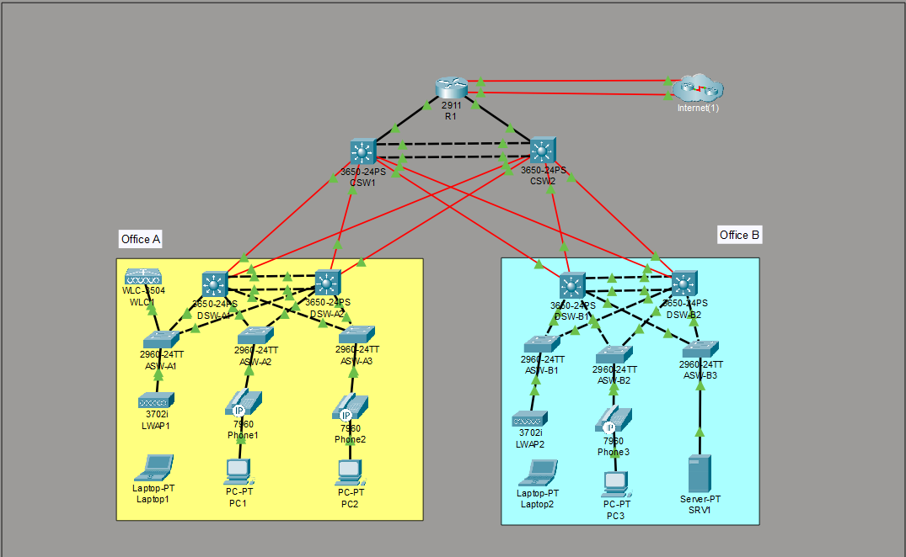

# Enterprise Network Architecture & Design

This document provides a comprehensive architectural overview of the Enterprise Campus Network. It details the physical and logical topology, layer responsibilities, strategic engineering decisions, and end-to-end traffic flows.

## 1. Network Topology Overview

The enterprise network is designed as a scalable, highly available campus connecting two distinct physical locations through a shared, high-speed routed backbone.

*   **Office A:** The primary user hub. It hosts wired endpoints (PCs and IP Phones) and the centralized Wireless LAN Controller (WLC) that manages the entire campus Wi-Fi infrastructure.
*   **Office B:** The secondary user hub and datacenter extension. It hosts user endpoints and the dedicated Server Farm (SRV1), which provides critical infrastructure services (DNS, Syslog, FTP).
*   **Shared Edge (R1):** A single integrated services router providing external connectivity. It handles NAT/PAT, serves as the central DHCP and NTP server for both offices, and manages automatic failover between two independent Internet Service Providers (ISPs).

---

## 2. Hierarchical Design (The 3-Tier Model)

The network strictly adheres to the Cisco 3-Tier Hierarchical Model to ensure predictable performance, fault isolation, and ease of scaling.

### Edge & External Routing (Layer 3)
*   **R1 (Edge Router):** Operates as an OSPF Autonomous System Boundary Router (ASBR). It dynamically injects a default route into the enterprise backbone. It holds two static recursive default routes (Primary and Floating) to handle ISP failover automatically.

### Core Layer (Layer 3 Backbone)
*   **CSW1 & CSW2:** A purely Layer 3 routed backbone connecting Office A, Office B, and R1. By eliminating Layer 2 domains at the core, Spanning Tree Protocol (STP) blocks are removed. The two core switches are interconnected via a **Routed EtherChannel**, allowing all core links to forward traffic simultaneously using OSPF Equal-Cost Multipath (ECMP).

### Distribution Layer (Layer 2 / Layer 3 Boundary)
*   **DSW Pairs (A1/A2 & B1/B2):** The critical boundary where routing stops and switching begins. These pairs act as the default gateways for all user VLANs using **HSRPv2**, handle inter-VLAN routing via Switched Virtual Interfaces (SVIs), and serve as DHCP relay agents. They are interconnected via Layer 2 EtherChannels (PAgP in Office A, LACP in Office B).

### Access Layer (Layer 2 Edge)
*   **ASW Switches:** Purely Layer 2 access switches connecting endpoints. They enforce the first line of security, including Port Security, DHCP Snooping, Dynamic ARP Inspection (DAI), and BPDU Guard. Each Access switch is dual-homed to both Distribution switches in its respective office.

---

## 3. Strategic Engineering Decisions

### Distributed HSRP & Spanning Tree Alignment
*   **Decision:** Active HSRP roles are distributed across the Distribution pairs. For example, DSW-A1 is the active gateway for VLANs 10 (PCs) and 99 (Management), while DSW-A2 is active for VLANs 20 (Phones) and 40 (Wi-Fi). Spanning Tree (Rapid PVST+) Root Bridge priorities are engineered to perfectly align with these HSRP roles.
*   **Rationale:** This active/active design ensures both Distribution switches and both Access uplinks actively forward traffic in a steady state, achieving per-VLAN load distribution. Aligning STP roots with HSRP prevents suboptimal Layer 2 paths across the inter-switch EtherChannel.

### Centralized Wireless Architecture (Split-MAC)
*   **Decision:** A centralized WLC in Office A manages Lightweight Access Points (LWAPs) in both offices via CAPWAP tunnels using Central Switching.
*   **Rationale:** This consolidates wireless policy, SSIDs, and WPA2-Enterprise security configurations in one location. All wireless client traffic terminates directly on VLAN 40 at the controller, keeping Wi-Fi traffic segmented from wired user VLANs across the entire campus.

### Zero-Trust Edge Security
*   **Decision:** Strict Layer 2 security features are applied exclusively at the Access layer.
*   **Rationale:** **Port Security** mitigates MAC flooding and unauthorized physical access. **DHCP Snooping** prevents rogue DHCP servers by trusting only uplinks. **Dynamic ARP Inspection (DAI)** leverages the snooping binding database to drop malicious ARP replies, preventing Man-in-the-Middle (ARP spoofing) attacks. 

### Separation of Infrastructure Services
*   **Decision:** Shared services are separated into distinct VLANs and devices. R1 handles routing-adjacent services (DHCP pools, NAT, NTP), while SRV1 in Office B handles internal services (DNS resolution, Syslog collection, FTP).
*   **Rationale:** This creates clear security boundaries and dependency paths. For instance, SRV1 is placed in an isolated VLAN (30) with static NAT (Inside Global: 203.0.113.113) applied at R1, allowing secure external access without exposing user subnets.

---

## 4. End-to-End Traffic Flows

### Scenario A: Local Inter-VLAN Routing (PC to Phone in Office A)
1.  A PC in VLAN 10 attempts to reach an IP Phone in VLAN 20. Recognizing the destination is off-subnet, the PC sends the packet to its default gateway (HSRP VIP 10.1.0.1).
2.  **DSW-A1** (Active for VLAN 10) receives the frame, performs a routing lookup, and finds the connected SVI for VLAN 20.
3.  Because **DSW-A2** is the STP Root and Active gateway for VLAN 20, DSW-A1 forwards the routed packet across the Layer 2 EtherChannel to DSW-A2, which then delivers it to the Access switch and down to the phone.

### Scenario B: Campus-to-Campus Routing (PC to Server in Office B)
1.  An Office A PC sends traffic destined for SRV1 (10.5.0.4) to its gateway (DSW-A1).
2.  DSW-A1 consults its OSPF routing table and utilizes **ECMP** to forward the packet to either Core switch (CSW1 or CSW2).
3.  The Core routes the packet to an Office B Distribution switch.
4.  The receiving Distribution switch routes the packet directly into the Server VLAN (30) Layer 2 domain, delivering it to SRV1.

### Scenario C: Outbound Internet & Failover (NAT/PAT)
1.  A PC sends outbound Internet traffic to its gateway, which follows the OSPF default route injected by R1 to the Core, and finally to R1.
2.  R1 matches the source subnet against an Extended ACL, translates the private IP to a public IP using **Dynamic PAT (Overload)**, and forwards it out the primary ISP link.
3.  *Failover:* If the primary ISP link physically drops, R1’s floating static route activates, seamlessly shifting outbound PAT traffic to the backup ISP.

---

## 5. High Availability & Fault Tolerance

The architecture eliminates single points of failure within the campus switching infrastructure. It transparently survives:
*   **Access Uplink Failure:** Rapid PVST+ promotes the alternate access uplink to a forwarding (Root Port) state within seconds, maintaining endpoint connectivity.
*   **Distribution Switch Failure:** The HSRP Standby peer immediately assumes the Virtual IP/MAC. OSPF dynamically routes around the failed node, and Rapid PVST+ recalculates the root bridge.
*   **Core Switch Failure:** OSPF dynamic routing shifts all inter-office and external traffic to the surviving Core switch with zero administrative intervention.
