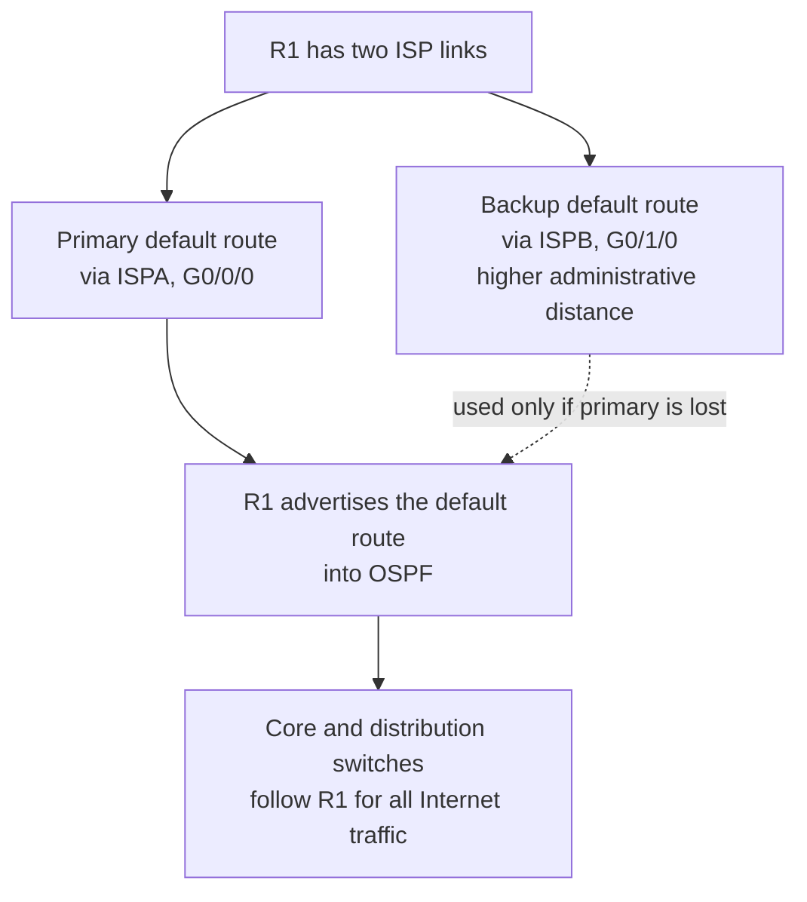
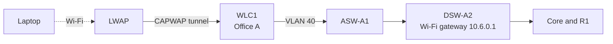
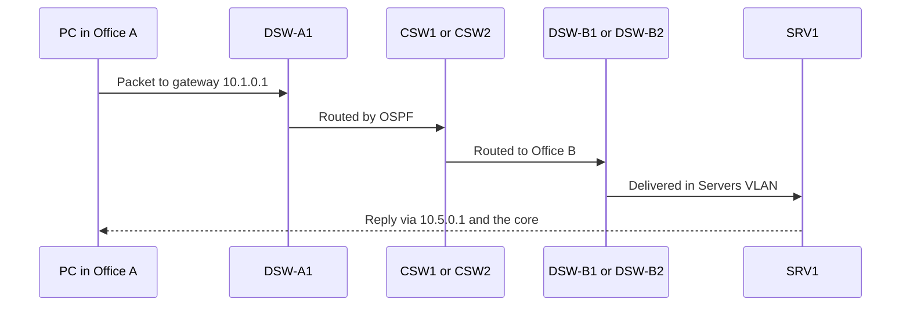
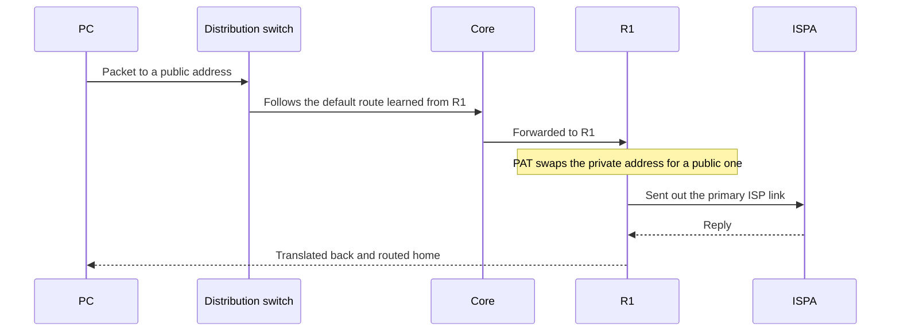
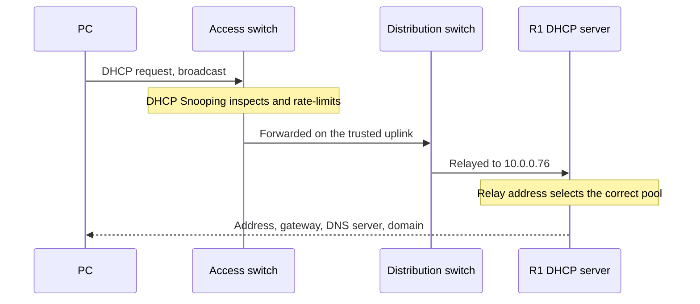

# Architecture
 
This document explains how the network is built, how its parts work together, and why it was designed this way.
 
 
## 1. Network Overview
 
Two offices share one core and one Internet edge. Each office has its own pair of distribution switches and three access switches. All traffic between the offices, and all traffic to the Internet, passes through the core.
 

 
**At a glance**
 
| | |
|---|---|
| Devices | 26 (1 router, 2 core, 4 distribution, 6 access, 1 wireless controller, 2 access points, 3 phones, 3 PCs, 2 laptops, 1 server) |
| Internet | Two ISP links on R1, primary and backup |
| Routing | OSPF Area 0 across R1, core, and distribution |
| Gateways | HSRPv2 on the distribution switches |
| Address space | 10.0.0.0/8 private ranges, with documentation ranges on the ISP side |
 
---
 
## 2. Device Roles
 
| Device | Model | Role |
|---|---|---|
| **R1** | Cisco 2911 | Edge router: Internet links, NAT, DHCP server, NTP source, default route |
| **CSW1, CSW2** | Catalyst 3650 | Core: Layer 3 backbone between R1 and both offices |
| **DSW-A1, DSW-A2** | Catalyst 3650 | Office A distribution: gateways, inter-VLAN routing, spanning-tree roots |
| **DSW-B1, DSW-B2** | Catalyst 3650 | Office B distribution: same role as Office A |
| **ASW-A1..A3, ASW-B1..B3** | Catalyst 2960 | Access: connect endpoints, assign VLANs, enforce edge security |
| **WLC1** | WLC-3504 | Wireless controller: defines the Wi-Fi network and manages the access points |
| **LWAP1, LWAP2** | 3702i | Lightweight access points: radios only, controlled by WLC1 |
| **Phone1..3** | Cisco 7960 | IP phones in the Phones VLAN |
| **PC1..3, Laptop1..2** | Packet Tracer | Wired PCs and wireless laptops |
| **SRV1** | Server | DNS, Syslog, and FTP server |
 
---
 
## 3. Layer Responsibilities
 
| Layer | Devices | Forwarding | What it does |
|---|---|---|---|
| **Edge** | R1 | Layer 3 | Connects to the Internet, translates addresses, hands out IP addresses, advertises the default route |
| **Core** | CSW1, CSW2 | Layer 3 only | Carries traffic between offices and R1. No user VLANs |
| **Distribution** | DSW-x1, DSW-x2 | Layer 3 and Layer 2 | Default gateway for every VLAN, routing between VLANs, DHCP relay, spanning-tree roots |
| **Access** | ASW-xn | Layer 2 only | Connects endpoints, places ports in VLANs, applies edge security |
 
**Why the switches differ even when the hardware is the same.** CSW1 and DSW-A1 are both Catalyst 3650s. CSW1 only routes between point-to-point links. DSW-A1 also hosts VLANs, gateways, and spanning tree, and routes between them. A device's layer comes from what it is configured to do, not from its model.
 
**Where routing stops.** Access switches never route. They only move frames within a VLAN and pass everything else to the distribution layer. Their single IP address, in the Management VLAN, exists so they can be administered.
 
**Why R1 connects only to the core.** Distribution switches never attach to R1. Both offices therefore reach the Internet the same way (distribution, then core, then R1), and R1 needs only two internal links no matter how many offices exist.
 
---
 
## 4. Office A and Office B
 
Both offices follow the same pattern: two distribution switches, three dual-homed access switches, and the same set of VLANs, with a few intentional differences.
 
### Office A
 

 
| ASW | Connected devices |
|---|---|
| ASW-A1 | WLC1 and LWAP1 (wireless infrastructure) |
| ASW-A2 | Phone1, with PC1 plugged into the phone |
| ASW-A3 | Phone2, with PC2 plugged into the phone |
 
### Office B
 

 
| ASW | Connected devices |
|---|---|
| ASW-B1 | LWAP2 |
| ASW-B2 | Phone3, with PC3 plugged into the phone |
| ASW-B3 | SRV1 |
 
### Comparison
 
| | Office A | Office B |
|---|---|---|
| Distribution and access | 2 + 3 | 2 + 3 |
| VLANs | 10 PCs, 20 Phones, 40 Wi-Fi, 99 Management | 10 PCs, 20 Phones, 30 Servers, 99 Management |
| Distribution EtherChannel | PAgP (Cisco protocol) | LACP (open standard) |
| Wireless | WLC1 and LWAP1 | LWAP2 only |
| Shared services | None | SRV1 |
| Gateway split | DSW-A1: VLAN 99, 10. DSW-A2: VLAN 20, 40 | DSW-B1: VLAN 99, 10. DSW-B2: VLAN 20, 30 |
 
VLAN IDs 10, 20, and 99 are reused in both offices with different subnets. This works because the offices are joined only at Layer 3.
 
---
 
## 5. How the Offices Connect
 
The offices are never joined at Layer 2. Every link above the distribution layer is a routed point-to-point link.
 
- Each **distribution switch** has two routed uplinks: one to CSW1 and one to CSW2.
- Each **core switch** has one link to every distribution switch, one link to R1, and a routed EtherChannel to the other core switch.
- Every device has a **loopback interface** that acts as its stable OSPF identity.
Because each distribution switch has two equal paths to the core, OSPF uses both. The core-to-distribution links do not need any tuning.
 
**Fault isolation:** a Layer 2 problem such as a loop or a bad trunk stays inside one office, because there is no Layer 2 path to the other.
 
---
 
## 6. Layer 2 Design
 
### VLANs
 
| VLAN | Name | Offices | Purpose |
|---|---|---|---|
| 10 | PCs | A and B | Wired user workstations |
| 20 | Phones | A and B | IP telephones |
| 30 | Servers | B only | SRV1 and shared services |
| 40 | Wi-Fi | A only | Wireless clients (the whole organization's Wi-Fi) |
| 99 | Management | A and B | Switch, access point, and controller management |
| 1000 | Unused | Trunks only | Native VLAN, carries no hosts |
 
### Trunks
 
- All links between access and distribution switches, and between distribution switches, are 802.1Q trunks.
- DTP is disabled, so no port can be talked into becoming a trunk.
- The native VLAN is the unused VLAN 1000, so no user traffic travels untagged.
- Each trunk carries only the VLANs that exist in its office.
- All unused ports are shut down.
### VLAN distribution
 
VTPv2 creates VLANs once on a distribution switch in each office and spreads them to the access switches. The two offices do not share VLAN information, because no trunk connects them.
 
### EtherChannel
 
| Bundle | Type | Protocol | Links |
|---|---|---|---|
| DSW-A1 to DSW-A2 | Layer 2 trunk | PAgP | 2 |
| DSW-B1 to DSW-B2 | Layer 2 trunk | LACP | 2 |
| CSW1 to CSW2 | Layer 3 routed | PAgP | 2 |
 
Each access switch has one uplink to each distribution switch. Because they go to different switches, those two uplinks cannot be bundled, and spanning tree manages them instead.
 
### Endpoint ports
 
- Edge ports use PortFast and BPDU Guard, so a rogue switch plugged into a user port is shut down.
- Each access switch has one designated end-device port with Port Security, DHCP Snooping limits, and LLDP transmission turned off.
- Phones connect directly to the switch, with the PC plugged into the phone.
---
 
## 7. Gateway Redundancy: HSRP and Spanning Tree
 
### The problem
 
A PC has one default gateway. If that gateway is a single switch and it fails, the PC loses all connectivity even though a second switch is available.
 
### The solution
 
Each VLAN has an **HSRPv2 virtual IP** shared by the two distribution switches. One switch is Active and answers for the virtual IP. The other is Standby and takes over if the Active switch stops responding. PCs always point at the virtual IP and never need to change.
 
### The split
 
The Active role is divided between the two switches in each office:
 
| Office | Group | VLAN | Gateway (virtual IP) | Active | Standby |
|---|---|---|---|---|---|
| A | 1 | 99 Management | 10.0.0.1 | DSW-A1 | DSW-A2 |
| A | 2 | 10 PCs | 10.1.0.1 | DSW-A1 | DSW-A2 |
| A | 3 | 20 Phones | 10.2.0.1 | DSW-A2 | DSW-A1 |
| A | 4 | 40 Wi-Fi | 10.6.0.1 | DSW-A2 | DSW-A1 |
| B | 1 | 99 Management | 10.0.0.17 | DSW-B1 | DSW-B2 |
| B | 2 | 10 PCs | 10.3.0.1 | DSW-B1 | DSW-B2 |
| B | 3 | 20 Phones | 10.4.0.1 | DSW-B2 | DSW-B1 |
| B | 4 | 30 Servers | 10.5.0.1 | DSW-B2 | DSW-B1 |
 
The intended Active switch has a slightly higher priority and preemption enabled, so it reclaims its role after a failure.
 
### Matching spanning tree to HSRP
 
Rapid PVST+ runs a separate spanning tree for each VLAN. In every VLAN, the **spanning-tree root is the same switch that is HSRP Active**, and the other switch is the backup root.
 

 
Why this matters:
- **Short path:** frames go straight from the access switch to the gateway, with no extra hop between distribution switches.
- **Both uplinks in use:** each access switch forwards some VLANs on one uplink and the rest on the other. Neither is idle.
- **Failover together:** if one distribution switch fails, the same peer takes over both the gateway role and the spanning-tree root.
HSRP and spanning tree are separate protocols. Aligning them is a deliberate design choice, not automatic.
 
---
 
## 8. Routing and Internet Access
 
### Inside the network
 
- **Inter-VLAN routing** happens on the distribution switches, using a virtual interface (SVI) for each VLAN.
- **OSPF Area 0** runs on R1, both core switches, and all four distribution switches. Router IDs are the loopback addresses.
- User VLAN interfaces are **passive**: their subnets are advertised, but no OSPF messages are sent toward hosts.
- Physical routed links use the **point-to-point** network type, so no designated-router election is needed.
### Reaching the Internet
 

 
- R1 has one default route per ISP. The backup route has a higher administrative distance (a floating static route), so it is used only when the primary disappears.
- R1 advertises its default route into OSPF. Core and distribution switches need no Internet routes of their own, because the whole network follows R1.
- **NAT:** SRV1 has a permanent public address (static NAT). PCs, phones, and Wi-Fi clients share a small pool of public addresses (PAT). Management and server subnets are not part of the shared pool.
### IPv6
 
IPv6 addressing is configured on the R1 and core links, along with a primary and backup IPv6 default route. This is groundwork for a future migration. IPv6 is not deployed on the distribution layer or on hosts.
 
---
 
## 9. Wireless
 
### Components
 
| Component | Role |
|---|---|
| **WLC1** | Holds the Wi-Fi network definition (SSID, WPA2/AES security) and controls the access points |
| **LWAP1, LWAP2** | Lightweight access points: they transmit the signal and forward everything to WLC1 |
 
A controller-based design means the Wi-Fi network is defined once and every access point receives it automatically, instead of configuring each access point by hand.
 
### How a wireless client gets online
 

 
1. The laptop joins the Wi-Fi network through the nearest access point.
2. The access point wraps the client's traffic in a tunnel (CAPWAP) and sends it to WLC1.
3. WLC1 places the client in the Wi-Fi VLAN and sends the traffic onto the wired network.
4. From there it reaches the VLAN 40 gateway and is routed like any other traffic.
### Office B
 
Wi-Fi VLAN 40 exists only in Office A, so wireless clients in Office B enter the wired network in Office A.
 
- **Benefit:** the Wi-Fi VLAN, gateway, and policy are defined in one place.
- **Trade-off:** Office B wireless traffic travels to Office A and back, and Office B wireless depends on WLC1 and ASW-A1.
---
 
## 10. Network Services
 
| Service | Hosted on | What it does for the network |
|---|---|---|
| **DHCP** | R1 | Seven address pools (management, PCs, phones for both offices, plus Wi-Fi). Servers use static addresses |
| **DHCP relay** | Distribution switches | Forwards client requests to R1's loopback address, since broadcasts cannot cross routers |
| **DNS** | SRV1 | Resolves lab domain names for all hosts and devices |
| **NTP** | R1 | Keeps device clocks in sync. Switches use R1 as an authenticated time source |
| **Syslog** | SRV1 | Collects logs from every router and switch |
| **SNMP** | All devices | Read-only monitoring |
| **FTP** | SRV1 | Source for IOS image transfers to R1 |
| **SSH** | All devices | Encrypted remote administration, allowed only from the Office A PC subnet |
 
**How DHCP relay works:** when a PC broadcasts for an address, its distribution switch forwards the request to R1 and includes its own address on that VLAN. R1 uses that address to pick the right pool. This is why each distribution switch has its own address in every VLAN subnet.
 
**Dependencies:** all services rely on routing working, and R1 and SRV1 each carry several services.
 
---
 
## 11. Security
 
Security is built in layers, with each control placed where it is most effective.
 
| Layer | Controls | Protects against |
|---|---|---|
| **Access ports** | Port Security, PortFast with BPDU Guard, unused ports shut down | Unauthorized devices, rogue switches |
| **DHCP and ARP** | DHCP Snooping with rate limits, Dynamic ARP Inspection | Rogue DHCP servers, ARP spoofing |
| **Trunks** | DTP off, native VLAN 1000, restricted VLAN lists | VLAN hopping, accidental trunking |
| **Inter-office policy** | Extended ACL between the two PC subnets | Unwanted access between offices |
| **Management** | SSHv2 only, ACL on remote lines, local accounts with hashed passwords, console timeout | Unauthorized administration |
| **Wireless** | WPA2 with AES | Eavesdropping and unauthorized access |
| **Discovery** | CDP off, LLDP not sent to end-device ports | Information leakage |
 
**The inter-office ACL:** Office A PCs can ping Office B PCs, but all other traffic from Office A PCs to Office B PCs is blocked. Everything else, including access to the server for DNS, is allowed.
 
---
 
## 12. Key Design Decisions
 
### Two distribution switches per office
- **Why:** one switch would be a single point of failure for an entire office.
- **Result:** every access switch has two uplinks to two different switches, and every VLAN gateway has a backup.
- **Trade-off:** twice the devices, plus HSRP and spanning tree to plan and manage.
### Split Active roles and aligned spanning tree
- **Why:** with one switch doing all the work, the other would sit idle.
- **Result:** both switches carry traffic, both access uplinks are used, and either switch can carry everything after a failure.
- **Trade-off:** more to plan. The roles of eight HSRP groups and eight spanning-tree roots must stay consistent.
### EtherChannel between paired switches
- **Why:** parallel links between the same two switches would otherwise be blocked by spanning tree or add no bandwidth.
- **Result:** two cables behave as one logical link, with more capacity and no outage if one cable fails.
- **Note:** traffic is shared by flow, so a single flow does not get double bandwidth.
### Layer 2 access with routing at distribution
- **Why:** this keeps access switches simple and lets any VLAN exist on any access switch in an office.
- **Trade-off:** it requires spanning tree and HSRP. A fully routed access layer would avoid both, but is less flexible for phones, access points, and servers.
### OSPF instead of static routes
- **Why:** routes update automatically, both core paths are used, and failed links are removed without manual changes.
### Central wireless controller
- **Why:** one place to define the Wi-Fi network and its security.
- **Trade-off:** one controller is a single point of failure, and Office B wireless traffic is carried through Office A.
---
 
## 13. Traffic Flows
 
### PC in Office A to the server in Office B
 

 
1. The PC sends the packet to its gateway, the virtual IP on DSW-A1.
2. DSW-A1 routes it to one of the two core switches.
3. The core sends it to an Office B distribution switch, which delivers it into the Servers VLAN.
4. SRV1 replies through its own gateway, and the reply returns through the core to Office A.
### PC to the Internet
 

 
1. The PC resolves the domain name through SRV1, then sends the packet to its gateway.
2. Every Layer 3 hop follows the default route that R1 advertises through OSPF.
3. R1 replaces the private address with a public one (PAT) and sends the packet out the primary ISP link.
4. If the primary link fails, R1 switches to the backup default route and sends traffic out the second ISP link.
### A PC getting an IP address
 

 
1. The PC broadcasts a DHCP request. The access switch checks it with DHCP Snooping.
2. The distribution switch relays the request to R1's loopback address.
3. R1 picks the pool that matches the relaying switch's VLAN address and replies.
4. The access switch records the lease, which Dynamic ARP Inspection later uses.
### A wireless laptop in Office B
 
1. The laptop joins the Wi-Fi network through LWAP2.
2. LWAP2 tunnels the traffic across the Office B and core networks to WLC1 in Office A.
3. WLC1 puts the traffic into the Wi-Fi VLAN and onto ASW-A1.
4. DSW-A2, the Wi-Fi gateway, routes it onward.
### An administrator using SSH
 
1. An administrator on an Office A PC opens SSH to a device address, for example ASW-B3 in the Management VLAN.
2. The packet is routed through DSW-A1, the core, and the Office B distribution switch.
3. The device checks that the source is in the allowed Office A PC subnet, then asks for a local login.
4. The same attempt from an Office B PC or from SRV1 is refused.
---
 
## 14. High Availability
 
| Failure | Expected behavior | How |
|---|---|---|
| One access uplink | Traffic moves to the other uplink, through the peer distribution switch if needed | Rapid PVST+ |
| One core-to-distribution link | Traffic uses the other core switch | OSPF, equal-cost paths |
| One cable in an EtherChannel | The bundle stays up with less capacity | EtherChannel |
| One distribution switch | The peer becomes gateway and spanning-tree root for all VLANs | HSRP, Rapid PVST+, OSPF |
| One core switch | The other core switch carries all traffic | OSPF |
| Primary ISP link | Traffic moves to the backup ISP link | Floating default route |
 
These behaviors are what the design is built to provide. The failover timing and exact results should be confirmed with failover tests.
 
**Single points of failure**
 
| Component | Impact if lost |
|---|---|
| **R1** | No Internet, no new DHCP leases, no NAT. Traffic inside the network keeps flowing |
| **WLC1** (and ASW-A1, which it connects through) | All wireless service in both offices |
| **SRV1** | DNS, Syslog, and FTP. IP connectivity itself is unaffected |
| **An access switch** | Only the devices attached to it |
 
Fixing these would take a second edge router, a second controller, and a second DNS and Syslog server. These are beyond the scope of this design.
