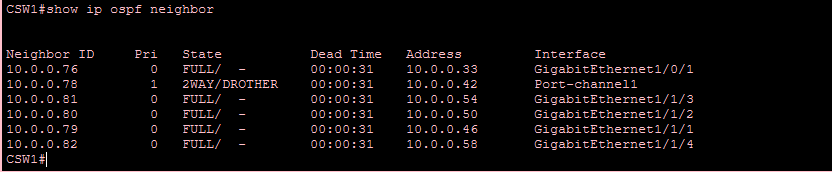
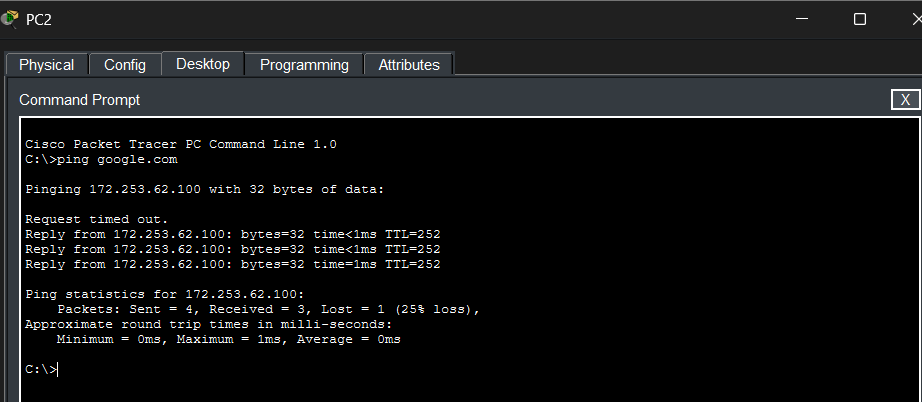
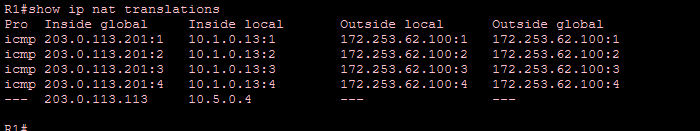
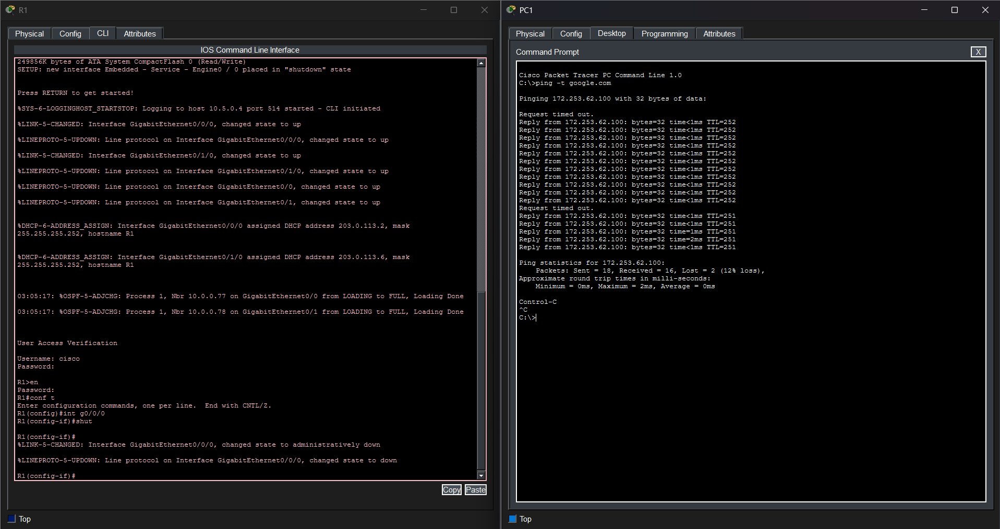
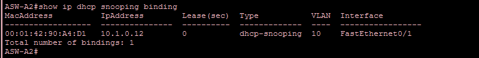
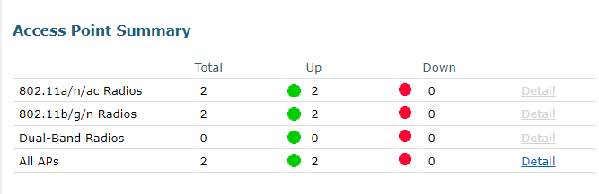

# Network Testing & Verification

This document contains live evidence of network convergence, security enforcement, and high-availability failover mechanisms from the Cisco Packet Tracer simulation.

## 1. Core Routing Convergence (OSPF Area 0)
*Proof that the Layer 3 backbone is fully converged.*
The output below from `CSW1` demonstrates stable OSPF adjacencies with the Edge Router (R1), the peer Core switch, and all four Distribution switches across point-to-point /30 links.

## 2. End-to-End Reachability & NAT/PAT
*Proof of DNS resolution and Internet access.*
The first image shows a successful ping from `PC1` (VLAN 10) to the external domain, resolving via the internal DNS server (`SRV1`). The second output from the `R1` terminal confirms that the private IP is dynamically translated to the `POOL1` public IP block.

## 3. High Availability: Dual-ISP Failover
*Proof of robust Edge design.*
During a continuous ping to the external domain, the primary ISP link (`G0/0/0` on R1) is physically shut down. The floating static route (Administrative Distance 2) instantly injects the backup default route into OSPF, restoring connectivity with minimal packet loss.

## 4. Zero-Trust Edge Security
*Proof of Access Layer hardening.*
The output from `ASW-A2` confirms that DHCP Snooping is actively building a trusted binding database.

## 5. Centralized Wireless Management (CAPWAP)
*Proof of Split-MAC Wireless Architecture.*
The WLC-3504 GUI confirms that both Lightweight Access Points (across different physical offices) have successfully obtained management IPs, discovered the WLC, and formed CAPWAP tunnels.

